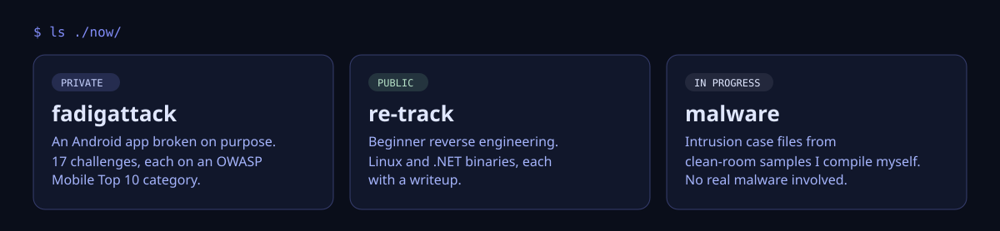

<table>
<tr>
<td width="260" valign="middle" align="center">

</td>
<td valign="middle">

I'm a student at INSAT and a member of Securinets, the security club. Most of my work goes into our CTFs: I write the challenges, and I build them to be beginner-friendly first. One real technique taught properly beats a hard puzzle with no lesson in it.

Android, reverse engineering and malware triage are where I spend most of my time.

</td>
</tr>
</table>

## What I'm on

The CTF repo has the public side: [re-track](https://github.com/khalilammarr/CTF/tree/main/re-track), the beginner reverse-engineering ladder, with writeups for each binary.

## Earlier work

- [Haniny](https://github.com/khalilammarr/Haniny-AI-Driver-Assistant-), an AI driver assistant
- [Next-Generation AI Honeypot](https://github.com/khalilammarr/Next-Generation_AI_Honeypot)
- [Gestion du Robot](https://github.com/khalilammarr/Gestion-Du-Robot-Java), a robot manager in Java
- [CTF writeups](https://github.com/khalilammarr/CTF)
