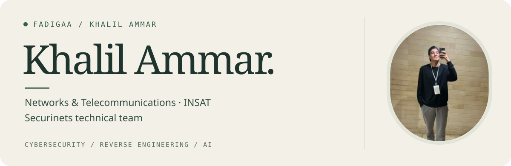

  <a href="https://khalilammar.me"><b>Portfolio</b></a> &nbsp; / &nbsp;
  <a href="https://khalilammar.me/blog"><b>Writeups</b></a> &nbsp; / &nbsp;
  <a href="https://www.linkedin.com/in/khalil-ammar-00665a334/"><b>LinkedIn</b></a> &nbsp; / &nbsp;
  <a href="mailto:mohamedkhalil.ammr@insat.ucar.tn"><b>Email</b></a>

 

### About

I’m a Networks and Telecommunications engineering student at **INSAT** and part of the **Securinets technical team**. I play CTFs, write challenges, and hunt for bugs.

My main interests are **malware analysis, reverse engineering, and mobile security**. I spend time tracing application behavior, reading decompiled code, debugging binaries, and testing how apps handle data and trust.

 

### What I work on

<table>
<tr>
<td width="50%" valign="top">
<h4>Mobile security</h4>

App reversing, runtime instrumentation, local storage, authentication, and certificate pinning.

My work so far has focused on Android; I plan to explore iOS too.

</td>
<td width="50%" valign="top">
<h4>Malware analysis &amp; reversing</h4>

Understanding program behavior, unpacking binaries, and working through anti-debugging checks.

</td>
</tr>
<tr>
<td valign="top">
<h4>Bug bounty</h4>

Looking for vulnerabilities in web and mobile applications.

</td>
<td valign="top">
<h4>CTFs</h4>

Competing, writing challenges, and helping run the infrastructure behind them.

</td>
</tr>
</table>

 

### AI &amp; agent systems

I explore how to get more out of AI through multi-agent orchestration, context engineering, and tool-augmented workflows. I’m interested in task decomposition, memory, and feedback loops—how agents coordinate, verify their outputs, and support security research and development within practical token, latency, and cost budgets.
