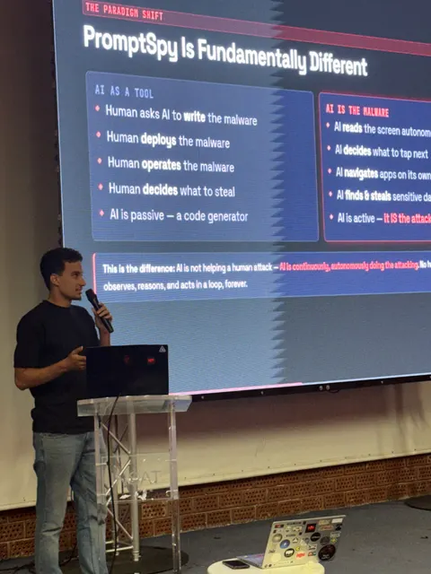
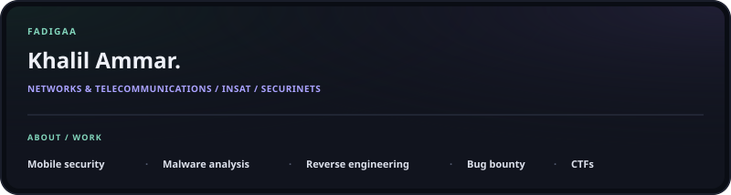

  

<picture>
  <source media="(max-width: 600px)" srcset="assets/profile-minimal-mobile-v8.svg" />
  
</picture>

  <a href="https://khalilammar.me"><b>Portfolio</b></a> &nbsp;·&nbsp;
  <a href="https://khalilammar.me/blog"><b>Writeups</b></a> &nbsp;·&nbsp;
  <a href="https://www.linkedin.com/in/khalil-ammar-00665a334/"><b>LinkedIn</b></a> &nbsp;·&nbsp;
  <a href="mailto:mohamedkhalil.ammr@insat.ucar.tn"><b>Email</b></a>

