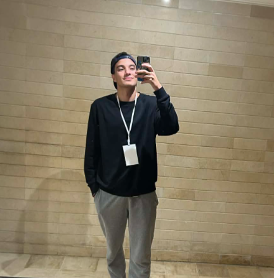

<table>
<tr>
<td width="250" valign="top">

</td>
<td valign="top">

I am a student at INSAT, in the Securinets security club. Most of what I make is for our CTFs:
Android, reverse engineering, and malware triage.

</td>
</tr>
</table>

## Now

**fadigattack.** An Android app that is broken on purpose. Seventeen challenges, each tied to an
OWASP Mobile Top 10 category. Private for now.

**re-track.** A beginner ladder of binaries for people who have never opened a disassembler.
Writeups included. [Read it here](https://github.com/khalilammarr/CTF/tree/main/re-track)

**Malware case files.** Intrusion stories built from samples I compile myself, so nothing in them is
a real sample and every artifact is one I can explain.

## Earlier

- [Haniny](https://github.com/khalilammarr/Haniny-AI-Driver-Assistant-): AI driver assistant
- [Next-Generation AI Honeypot](https://github.com/khalilammarr/Next-Generation_AI_Honeypot)
- [Gestion du Robot](https://github.com/khalilammarr/Gestion-Du-Robot-Java): robot manager in Java
- [CTF writeups](https://github.com/khalilammarr/CTF)

Everything I have public is listed on my profile. If something is private, ask me.
