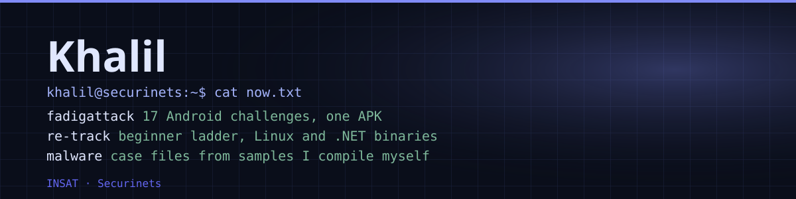
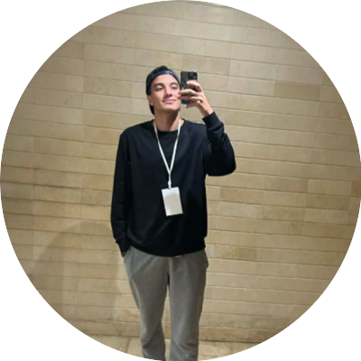

<table>
<tr>
<td width="260" valign="middle" align="center">

</td>
<td valign="middle">

I'm a student at INSAT and a member of the technical team at Securinets, the security club. I play CTFs and I write them: the challenges, the flags, and the parts that have to hold up once players start breaking them.

Cybersecurity is the thing I keep coming back to. I'm most drawn to taking software apart to see how it really works: reverse engineering, Android internals, and what malware does once it runs.

</td>
</tr>
</table>

## Roles

