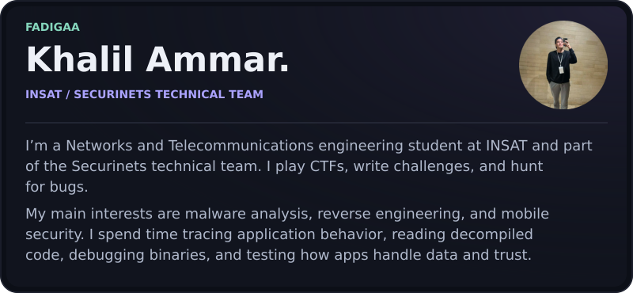
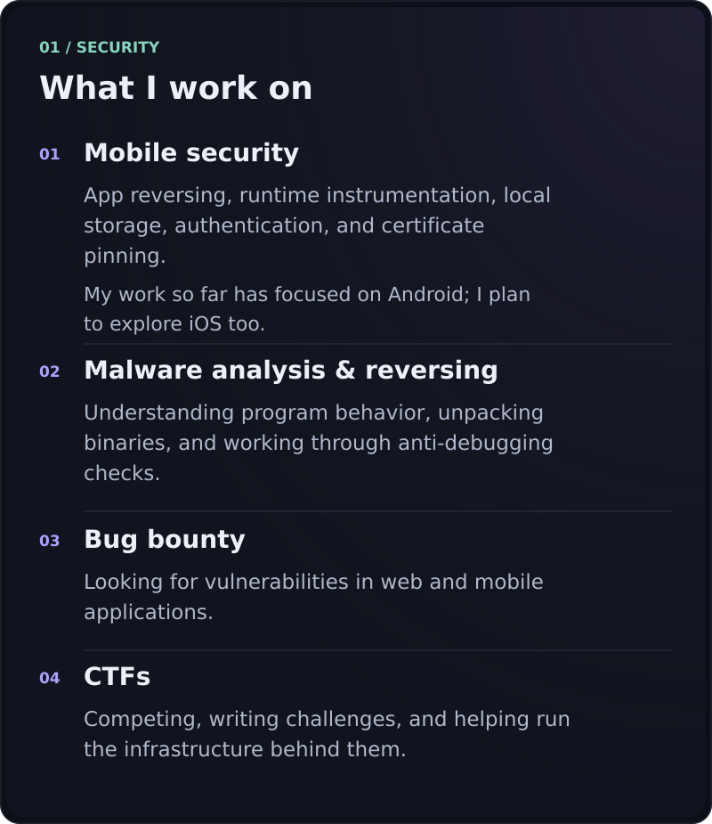
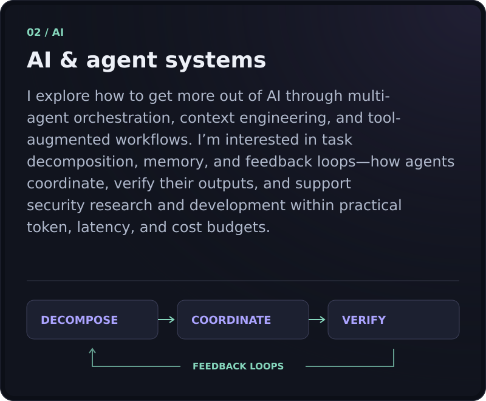

<picture>
  <source media="(max-width: 600px)" srcset="assets/profile-mobile-about.svg" />
  
</picture>

<picture>
  <source media="(max-width: 600px)" srcset="assets/profile-mobile-security.svg" />
  
</picture>

<picture>
  <source media="(max-width: 600px)" srcset="assets/profile-mobile-ai.svg" />
  
</picture>

  
  
  
  

