Hi, I'm Khalil. I like finding out how things work when nobody gave me the source: opening an APK to see what it really sends home, stepping through a binary until its check makes sense, or watching a detection fire and asking why it didn't fire sooner. Lately I spend as much time building puzzles like that for other people as I do solving them.

### Studies

Networks and telecommunications engineering at [INSAT](https://insat.rnu.tn), the National Institute of Applied Science and Technology in Tunis. The networking side is why I care as much about what goes over the wire as about what runs on the device.

### Securinets INSAT

I'm on the technical team of [Securinets INSAT](https://github.com/securinets-insat), the university's cybersecurity club, in the reverse engineering sub-team. I write CTF challenges, mostly mobile and reverse engineering, give workshops, and help first-year students who are just getting started. Outside the club I play CTFs with MOJO-JOJO as `fadigaa`; we took first place in the advanced CTF at Cybersphere Congress 7.0.

### What I work with

- **Reverse engineering:** IDA Pro, Ghidra, GDB, angr; native x86-64 and Go binaries, anti-debugging.
- **Mobile security:** jadx, apktool, Frida, objection, Burp Suite; Android and iOS apps, certificate pinning, local storage, app-to-backend APIs.
- **Detection and response:** Wazuh, Sysmon, Suricata, TheHive, Shuffle; writing rules against MITRE ATT&CK techniques.
- **Code:** Python, C, Kotlin, Java, Bash and some Swift.
- **Certifications:** CRTOM (Red Team Leaders), CPPS (Hack & Fix), TryHackMe Jr Penetration Tester path.

### Elsewhere

Writeups and the challenges I've built are on [khalilammar.me](https://khalilammar.me). You can also find me on [LinkedIn](https://www.linkedin.com/in/khalil-ammar-00665a334/) or write to mohamedkhalil.ammar@insat.ucar.tn.
